# iiko Analytics — частые вопросы

Аналитика ресторана прямо в Telegram. Подключение за 2 минуты, без приложений и логинов в iikoOffice.

---

## 🧐 Что это вообще?

Telegram Mini App, который читает данные из вашего iiko и собирает их в простые цифры: выручка, средний чек, гости, фудкост, накладные, цены поставщиков. Открывается из бота на телефоне.

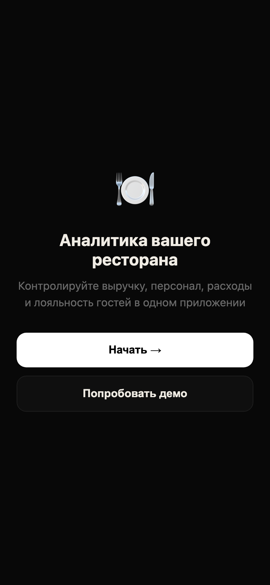

---

## 🚀 С чего начать?

Нажмите **«Попробовать демо»** на стартовом экране — увидите как всё работает на тестовых данных. Когда захотите подключить свой ресторан, дайте боту URL iiko и логин/пароль (см. раздел «Безопасность» ниже).

---

## 📊 Что я вижу на главном экране?

Три ключевые метрики за выбранный период + график выручки за 7 дней:

- **Выручка сегодня** с дельтой к вчера
- **Средний чек** с дельтой
- **Гости** — сколько человек у вас сегодня обслужили

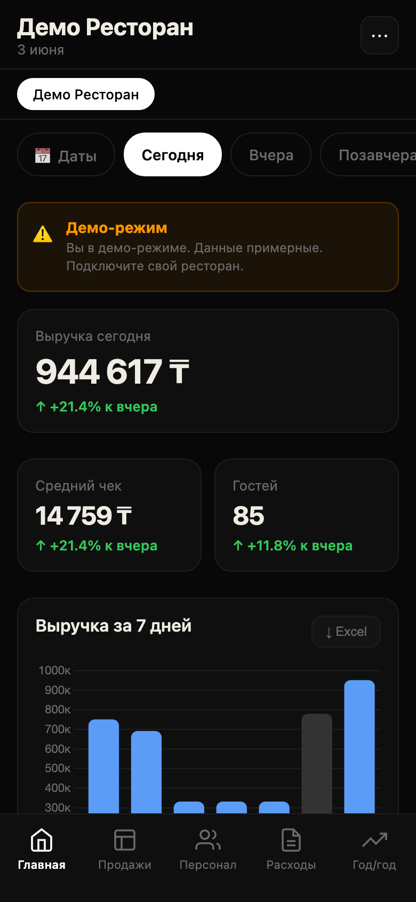

Период переключается чипами сверху: **Сегодня / Вчера / Позавчера / Эта неделя / Месяц / Свои даты**.

---

## 💰 Откуда приходит выручка? (вкладка Продажи)

Разбивка по каналам: Зал, Доставка, Самовывоз, Банкеты, Кейтеринг, Стафф. Видно сразу, какой канал тащит, а какой проседает.

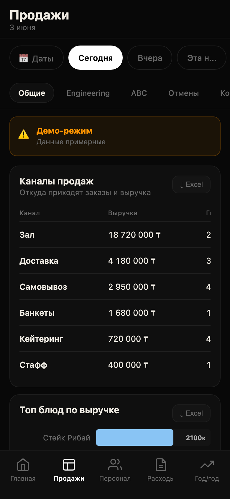

Под каналами — топ-блюд по выручке, ABC-анализ (что из меню реально продаётся), отмены и сторно (где теряете деньги).

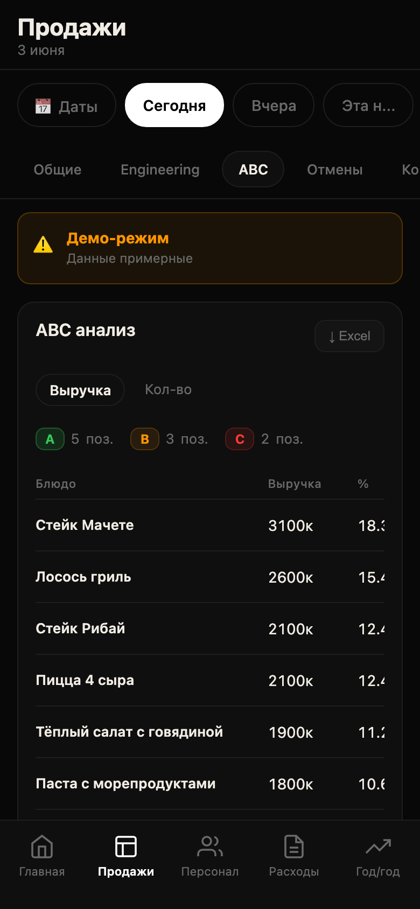

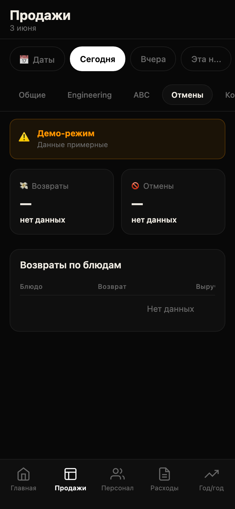

---

## 👥 Кто работает и сколько генерирует? (вкладка Персонал)

Сейчас на смене — кто, с какого часа, сколько уже принёс. Плюс таблица за 7 дней по всем официантам с сортировкой.

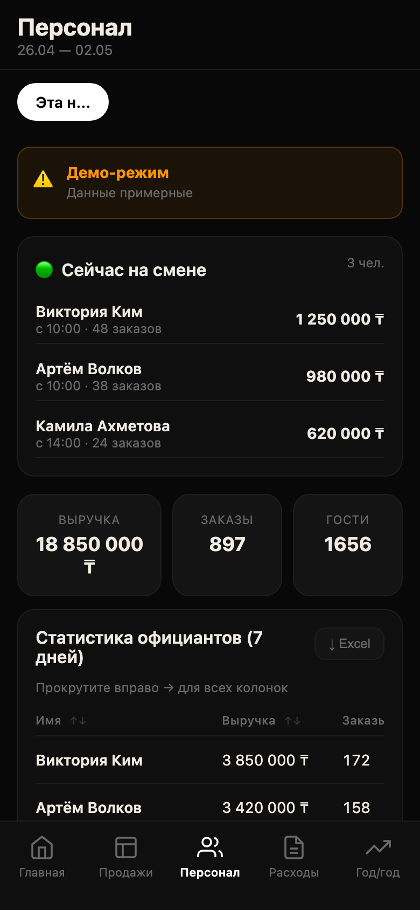

Подходит чтобы видеть, кто из официантов «звезда», а кто стоит у стенки.

---

## 🍽 Фудкост — переплачиваем или нет? (Расходы → Фудкост)

Сравниваем **норматив** (что должно быть по технологическим картам iiko) с **фактом** (что закупили). Разница = потери или экономия.

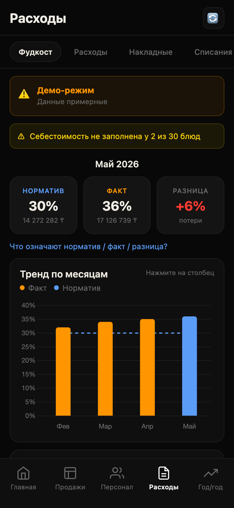

В тренде по месяцам видно, идёт ли ситуация к лучшему или ухудшается. Кликом по столбцу можно провалиться в детали месяца.

---

## 📄 А что с накладными? (Расходы → Накладные)

Все приходные накладные из iiko в одном списке, с фильтром по периоду:

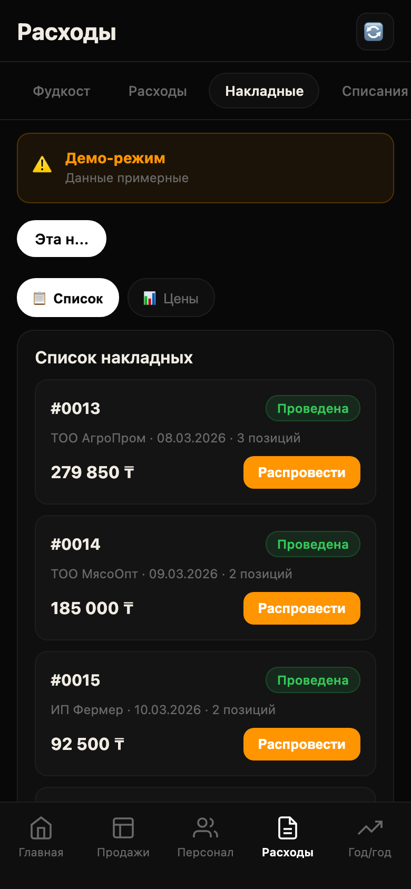

Статусы видны цветом: **Проведена** (зелёная) / **Новая / Черновик** (жёлтая) / **Ошибка** (красная). По кнопке справа можно **провести** или **распровести** накладную в iiko **прямо из Telegram** — не открывая iikoOffice.

> *Как загрузить накладную в бота из фото / PDF — в отдельной инструкции. Здесь только обзор.*

---

## 🔥 Самое вкусное: анализ цен накладных

Открываем вкладку **«📊 Цены»** и ищем любой товар:

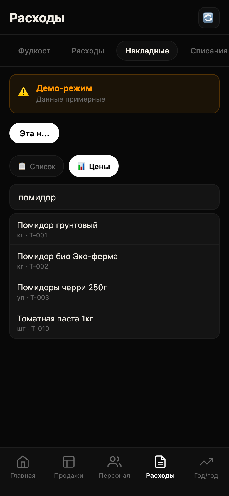

Кликаем — и видим **лучшую цену за 60 дней** + всех поставщиков, у которых вы этот товар покупали, с **дельтой в процентах**:

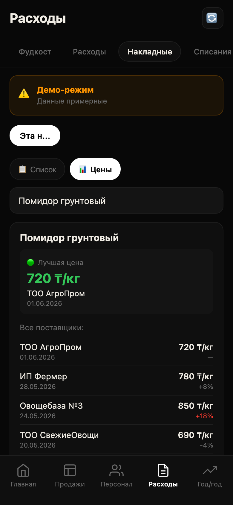

**Что это даёт:**
- Сразу видно, что **«Овощебаза №3»** продаёт помидоры на **+18% дороже** чем «ТОО АгроПром» — повод позвонить и сторговаться
- Видна **динамика цен**: когда последний раз закупались по 720 ₸/кг, когда по 990
- На карточке не только товар — там же история **по всем поставщикам**, что и сколько вы у них берёте

Бесплатные конкуренты этого не делают: iikoOffice требует строить OLAP-отчёт руками и не подсвечивает «вы переплачиваете».

---

## 📈 Растём год к году? (вкладка Год/Год)

Текущий год vs прошлый. По неделям или по месяцам. С фильтром по каналу — например, отдельно смотреть только Доставку.

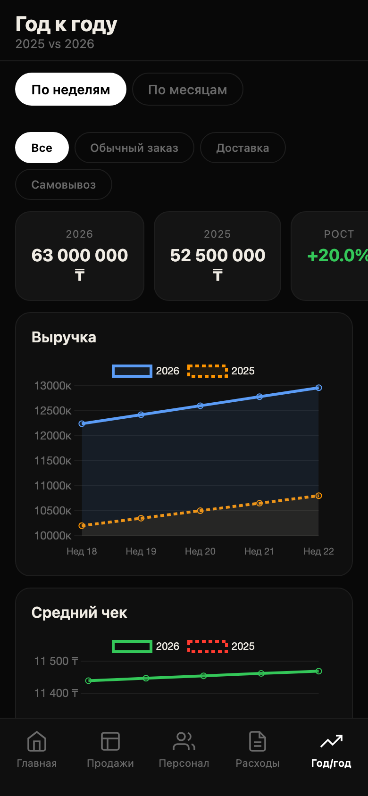

В верхних карточках — итоги, в графике — динамика помесячно/понедельно. Сразу видно, где провисли по сравнению с прошлым годом.

---

## ⚙️ Несколько ресторанов?

В настройках можно добавить столько ресторанов, сколько у вас iiko-аккаунтов. В шапке главной — переключатель между ними или режим **«Все филиалы»** (метрики суммируются по сети).

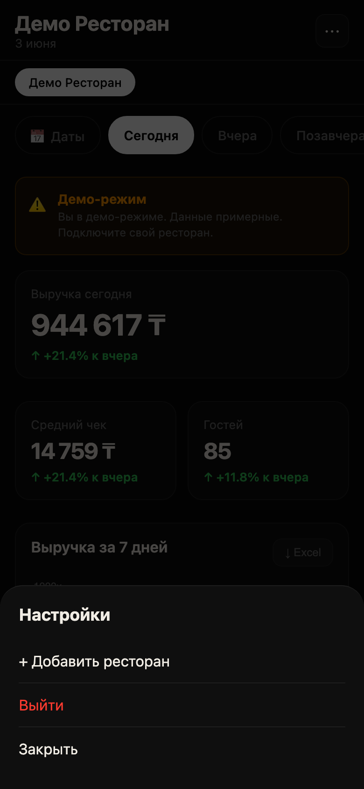

---

## 🛡 Безопасно ли давать вам логин от iiko?

- Пароль iiko **шифруется на сервере** (Fernet/AES) перед записью в базу. В открытом виде нигде не лежит.
- Mini App ходит в **ваш** iiko-сервер, не в общий — данные не пересекаются с другими клиентами.
- Telegram-авторизация проверяется по подписи `initData` от вашего бота, подменить нельзя.

Рекомендуем завести в iikoOffice **отдельную учётку** для бота с правом «только чтение» + право проведения накладных (если хотите проводить из Mini App). API-доступ всегда можно отозвать одной кнопкой в iikoOffice.

---

## 🤔 Что-то показывает 0 за сегодня, хотя касса работает

Это **особенность вашего iiko**, не баг приложения. Возможные причины:

1. **iiko-сервер агрегирует филиалы батчем.** Если у вас сеть с центральным iikoChain, продажи с касс синхронятся туда обычно при закрытии смены, а не онлайн. После 24:00 / закрытия смены данные появятся.
2. **Права API-пользователя.** В iikoOffice у роли может стоять «видеть только закрытые периоды». Уберите галку — и сегодняшняя выручка появится в реальном времени.
3. **iikoFront временно потерял связь с сервером.** Пробитые чеки накопятся локально на кассе и зальются при восстановлении.

Если данные за прошлые дни нормальные, а 0 только за сегодня — это всегда один из этих трёх случаев, не проблема Mini App.

---

## 📤 Можно ли выгрузить отчёт?

Да. На каждом разделе есть кнопка **«↓ Excel»** — экспорт текущей таблицы. Excel-файлы открываются в `.csv` / `.xlsx`, готовые к работе с бухгалтером.

---

## 💸 Сколько стоит?

Подписка на ресторан. Демо-режим — бесплатно, без ограничения по времени.
